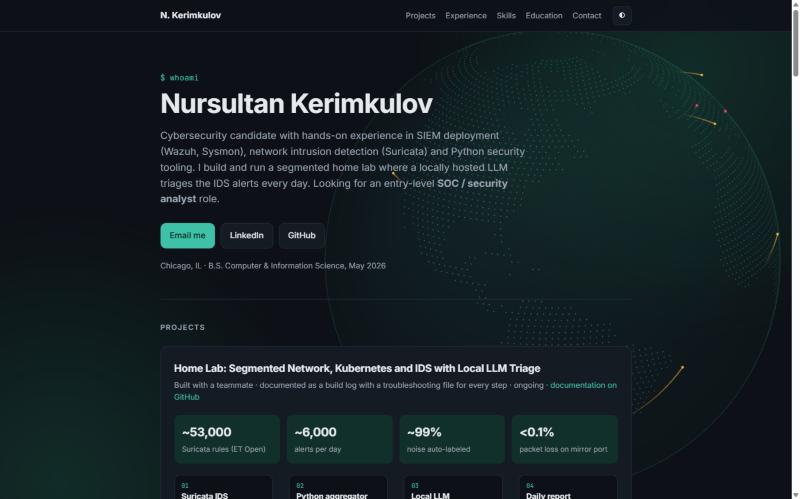

# Nursultan Kerimkulov — Resume Site

**Entry-level SOC / Security Analyst** · Chicago, IL · B.S. Computer & Information Science (May 2026)

[**🌐 Live site**](https://sinonar.github.io) · [LinkedIn](https://www.linkedin.com/in/nkerimkulov) · [Google Cybersecurity Certificate](https://coursera.org/verify/professional-cert/74ENDDBBP5MA) · [Home lab docs](https://github.com/MrSandwick/homelab-doc)

[](https://sinonar.github.io)

A one-page portfolio that shows what I have actually built and investigated: a home lab where a local LLM triages IDS alerts every day, and a Wazuh SIEM internship with detections mapped to MITRE ATT&CK.

---

## What's on the site

### 🛡️ Home lab: segmented network, Kubernetes and IDS with local LLM triage
*Built with a teammate. My parts are listed below.*

| | |
|---|---|
| **Network** | TP-Link Omada router, managed switch and AP; Users and Admin VLANs, inter-VLAN ACLs, WPA2-Enterprise through FreeRADIUS; port mirroring and ntopng |
| **IDS** | Suricata 8 on a mirrored port: about 53,000 ET Open rules, below 0.1% packet loss |
| **Alert triage** | A Python aggregator labels about 99% of roughly 6,000 daily alerts as known noise; a local LLM (Ollama, `gemma3:4b`) gives a verdict per remaining group; a systemd timer delivers a daily report |
| **Design rule** | *Code computes, the model only narrates.* Small models corrupted numbers in tests, so the model never handles a count, and code blocks it from marking an attack signature benign |
| **Model choice** | `qwen2.5:3b`, `phi4-mini` and `gemma3:4b` compared on 30 days of real alerts; the most conservative model won |
| **Finding** | The IDS caught scanning of a newly exposed public web server (`/.env`, `wp-config`, GraphQL probes) and showed that it sat in the Admin VLAN. That led to a DMZ VLAN plan |
| **GPU node** | Laptop added as a Kubernetes worker with NVIDIA Container Toolkit and the device plugin |

### 🔎 Cybersecurity internship: National Louis University (Jan to Apr 2026)
- Deployed a **Wazuh SIEM** with agents on Windows and Linux, plus **Sysmon** for endpoint telemetry
- Built and tuned three detections and validated each with a safe attack simulation:

| Detection | Log source | Wazuh rule | MITRE ATT&CK |
|---|---|---|---|
| Encoded PowerShell | Sysmon Event ID 1 | 92057 | T1059.001 |
| Scheduled task creation | Windows Security 4698 | 60228 | T1053.005 |
| Multiple failed logons | Windows Security 4625 | 60122 | T1110 |

- Debugged custom rules (`local_rules.xml`, `<if_sid>` chaining) with `wazuh-logtest`
- Triaged the alerts like a Tier-1 analyst and wrote **triage runbooks**; screenshots from the lab are on the site

### 🧰 Also on the site
- **Python Network Reconnaissance Toolkit:** TCP port scanner with banner grabbing, and a ping-sweep host discovery tool
- **Log analysis and brute-force detection tool:** parses Linux auth logs and flags repeated failed logins
- **Skills:** Wazuh, Sysmon, Suricata, MITRE ATT&CK · TCP/IP, VLANs, ACLs, VPN, FreeRADIUS · Linux, Docker, Kubernetes, Prometheus, Grafana · Python, SQL
- **Certifications:** Google Cybersecurity Professional Certificate · NASA's Open Science

---

## 🔐 Security built into the site

The site is small, but it is built the way I would want a security-minded page to be:

| Feature | What it protects against |
|---|---|
| **Leave-site confirmation:** every external link shows the site name, the full URL with the domain highlighted, and an HTTPS / HTTP badge before opening | Phishing through look-alike links; the domain is shown in punycode, so Unicode look-alike domains are visible |
| **Contact form with a review step:** shows *From → To*, subject and message before anything leaves the page | Accidental or misleading sends |
| **User input is rendered as text only (`textContent`), never as HTML** | Cross-site scripting (XSS) |
| **Line breaks stripped from the name and subject** | Email header injection (for example a hidden `Bcc:`) |
| **Honeypot field** | Spam bots |
| **`noopener noreferrer` on every external link, strict referrer policy** | Reverse tabnabbing and leaking the visitor's path to other sites |
| **No backend, no cookies, no analytics** | Nothing to breach and nothing to track; messages go out through the visitor's own mail service |

---

## ⚙️ How it is built

- **One static file:** `index.html` with inline CSS and JavaScript, no framework and no build step
- **Background:** a rotating dot-matrix globe with animated "attack" arcs, drawn on `<canvas>`. Land shapes come from [world-atlas](https://github.com/topojson/world-atlas) via [topojson-client](https://github.com/topojson/topojson-client). The arcs are random and decorative, not real threat data
- **Light and dark themes** that follow the system setting, with a toggle; the animation speed is time-based, so it looks the same on 60 Hz and 144 Hz screens
- **Accessible:** mobile layout, native `<dialog>` modals (Esc closes, focus starts on the safe choice), and `prefers-reduced-motion` support
- **Hosting:** GitHub Pages from the `main` branch; every push redeploys in about a minute

```
.
├── index.html          # the whole site
├── img/                # Wazuh lab screenshots and the README preview
└── README.md
```

### Run locally
```bash
git clone https://github.com/SiNONaR/SiNONaR.github.io.git
cd SiNONaR.github.io
python -m http.server 8000   # then open http://localhost:8000
```

---

## 📬 Contact

Open to **entry-level SOC / security analyst** roles. The quickest way to reach me is the **Email me** button on the [site](https://sinonar.github.io) or [LinkedIn](https://www.linkedin.com/in/nkerimkulov).
